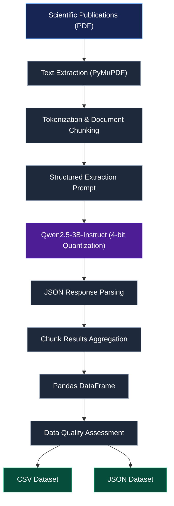

# 🧬 Scientific Research Data Extraction with Local LLMs

**Transforming unstructured scientific literature into structured research datasets with a locally deployed large language model.**


---

## 🧾 Overview

Scientific publications contain valuable information about research objectives, methodologies, interventions, and findings, but much of it is locked in **unstructured PDF documents**.

This project explores **LLM-based scientific information extraction** using **Qwen2.5-3B-Instruct**, a locally deployed language model. It processes a small collection of **six scientific papers** and organizes predefined research variables into a standardized dataset, with one row per publication.

The objectives are to:

- 🔬 Extract research metadata, study characteristics, and findings from scientific literature.
- 🤖 Run inference locally with an open-weight LLM and GPU-efficient quantization.
- 📊 Export structured, reusable **CSV and JSON** datasets.
- 🧩 Represent unavailable or inapplicable information with **null values**, rather than invented data.

Developed as coursework in **Big Data Science**. Although motivated by pharmaceutical research workflows, the sample papers cover broader topics including placebo effects, psychology, and depression research; they are **not all pharmaceutical clinical trials**.

---

## ⚙️ Methodology

### 📄 1. PDF Text Extraction

**PyMuPDF** reads the PDFs from `data/raw/` and extracts text from their pages.

### 🧠 2. Local LLM Inference

**Qwen2.5-3B-Instruct** is loaded with Hugging Face Transformers and PyTorch. **4-bit NF4 quantization** via BitsAndBytes helps reduce GPU memory usage on consumer hardware.

### ✍️ 3. Prompt Engineering

The prompt specifies the required JSON fields and instructs the model to:

- Use only information supported by the supplied text.
- Return `null` for missing or inapplicable values.
- Distinguish findings from the current paper from studies cited in its references.
- Produce a JSON object with the requested keys.

### 🧩 4. Parsing and Tabulation

Generated JSON responses are parsed into Python dictionaries and consolidated into a **Pandas DataFrame**.

### 📦 5. Export

The resulting table is saved as **CSV** and **JSON** for further analysis.

> **Scope of the current implementation:** The notebook limits the document text supplied to the LLM to the **first 2,000 tokens** of each paper. This is a proof of concept, not exhaustive full-document extraction. Information appearing later in a paper may be missed.

---

## 🔄 Extraction Pipeline



## 🧪 Technical Setup

| Component              | Configuration                                  |
| ---------------------- | ---------------------------------------------- |
| Language model         | Qwen2.5-3B-Instruct                            |
| Framework              | PyTorch                                        |
| Model interface        | Hugging Face Transformers                      |
| Quantization           | BitsAndBytes, 4-bit NF4                        |
| Compute precision      | FP16                                           |
| Development GPU        | NVIDIA GeForce RTX 4050 Laptop GPU (6 GB VRAM) |
| PDF processing         | PyMuPDF                                        |
| Data processing        | Pandas                                         |
| Generation             | `do_sample=False`                              |
| Current document input | First 2,000 document tokens                    |
| Output formats         | CSV and JSON                                   |

---

## 📋 Extracted Research Variables

Each publication is represented by a `source_file` identifier and **13 extracted variables**.

| Variable             | Description                                          |
| -------------------- | ---------------------------------------------------- |
| `source_file`        | Original PDF filename                                |
| `title`              | Publication title                                    |
| `authors`            | Publication authors                                  |
| `publication_year`   | Year of publication                                  |
| `doi`                | Digital Object Identifier                            |
| `research_type`      | Type of research                                     |
| `research_objective` | Main research objective                              |
| `methodology`        | Methods used                                         |
| `sample_size`        | Sample size in original experiments, when applicable |
| `intervention`       | Intervention investigated, when applicable           |
| `control_group`      | Control condition or group, when applicable          |
| `main_findings`      | Main findings                                        |
| `limitations`        | Reported limitations                                 |
| `conclusions`        | Main conclusions                                     |

**Missing values:** Not every article reports an original experiment. Experimental fields should remain `null` for theoretical or review papers when not applicable. Model-generated values still require verification against the source PDFs.

---

## 📊 Outputs

The pipeline targets a **six-row dataset with 14 columns**: one document identifier and 13 research variables.

| Output                                        | Purpose                                      |
| --------------------------------------------- | -------------------------------------------- |
| `data/processed/pharma_research_dataset.csv`  | Spreadsheet-friendly research table          |
| `data/processed/pharma_research_dataset.json` | Structured records for downstream processing |

For a visual overview, a future extension could include a **field-completeness chart** showing how many publications contain non-null values for each variable. No extraction-accuracy benchmark is claimed here because the current project does not include manually annotated ground truth.

---

## 🗂️ Project Structure

```text
LLM-Based-Pharma-Data-Extraction/
├── data/
│   ├── raw/                         # Source scientific PDFs
│   └── processed/
│       ├── pharma_research_dataset.csv
│       └── pharma_research_dataset.json
├── notebooks/
│   └── Pharma_Data_Extraction.ipynb
├── .gitignore
├── README.md
└── requirements.txt
```

---

## 🚀 Running the Project

### 1. Clone the repository

```bash
git clone https://github.com/LydiaRuizMartinez/LLM-Based-Pharma-Data-Extraction.git
cd LLM-Based-Pharma-Data-Extraction
```

### 2. Create and activate a virtual environment

```powershell
python -m venv .venv
.\.venv\Scripts\Activate.ps1
```

### 3. Install dependencies

For GPU inference, install a **CUDA-compatible PyTorch build** appropriate for your system, following the [official PyTorch installation instructions](https://pytorch.org/get-started/locally/). Then install the project's dependencies:

```powershell
python -m pip install -r requirements.txt
```

### 4. Run the notebook

Open `notebooks/Pharma_Data_Extraction.ipynb` in VS Code or Jupyter, select the `.venv` kernel, and execute the cells in order.

The notebook reads the PDFs, loads the model, extracts structured fields, creates a DataFrame, and exports CSV/JSON files. **The first model load downloads weights** from Hugging Face; later runs can reuse the local cache.

> **Reproducibility:** Input PDFs must be present in `data/raw/`. If distributing them, check each paper's reuse license and attribution requirements.

---

## ⚠️ Limitations

- **Partial document coverage:** Only the beginning of each paper is supplied to the model in the current implementation.
- **Hallucination risk:** A valid JSON response is not proof that every extracted fact is correct.
- **Heterogeneous source material:** The papers include experimental and non-experimental research; some fields are not applicable.
- **No formal accuracy evaluation:** Precision, recall, and field-level extraction accuracy have not been measured against a labeled reference dataset.
- **Hardware and dependency variability:** Local inference performance and quantization compatibility depend on the installed software and GPU.

---

## 🔮 Future Improvements

- 📚 **Full-document extraction:** Chunk papers and combine evidence across sections.
- 🔎 **Retrieval-augmented extraction:** Retrieve relevant passages for each target variable.
- 🧾 **Source traceability:** Save supporting quotations and page references alongside extracted values.
- ✅ **Schema validation:** Validate field types and JSON outputs with Pydantic.
- 📈 **Evaluation:** Build a manually annotated test set and measure extraction quality.
- ⚖️ **Model comparison:** Benchmark alternative local LLMs under the same conditions.
- 📊 **Visualization:** Add field-completeness charts and an interactive results preview.

---

## 🔬 Potential Applications

- 💊 Pharmaceutical research and evidence organization
- 📚 Scientific literature screening and review
- 🧪 Comparison of research methods and study characteristics
- 🤖 Biomedical natural language processing
- 📊 Preparation of structured data for downstream analytics

---

## 👩‍💻 Author

**Lydia Ruiz Martínez** · [GitHub](https://github.com/LydiaRuizMartinez)

**BSc in Mathematical Engineering & Artificial Intelligence** — Universidad Pontificia Comillas (ICAI)  
**Exchange Student** — University of Illinois Urbana-Champaign  
**MSc in Big Data Science** — University of Navarra

---

## 📚 References

- [Qwen2.5-3B-Instruct — Model Card](https://huggingface.co/Qwen/Qwen2.5-3B-Instruct)
- [Hugging Face Transformers — Documentation](https://huggingface.co/docs/transformers/index)
- [PyTorch — Documentation](https://pytorch.org/docs/stable/index.html)
- [PyMuPDF — Documentation](https://pymupdf.readthedocs.io/)
- [QLoRA: Efficient Finetuning of Quantized LLMs](https://arxiv.org/abs/2305.14314)
